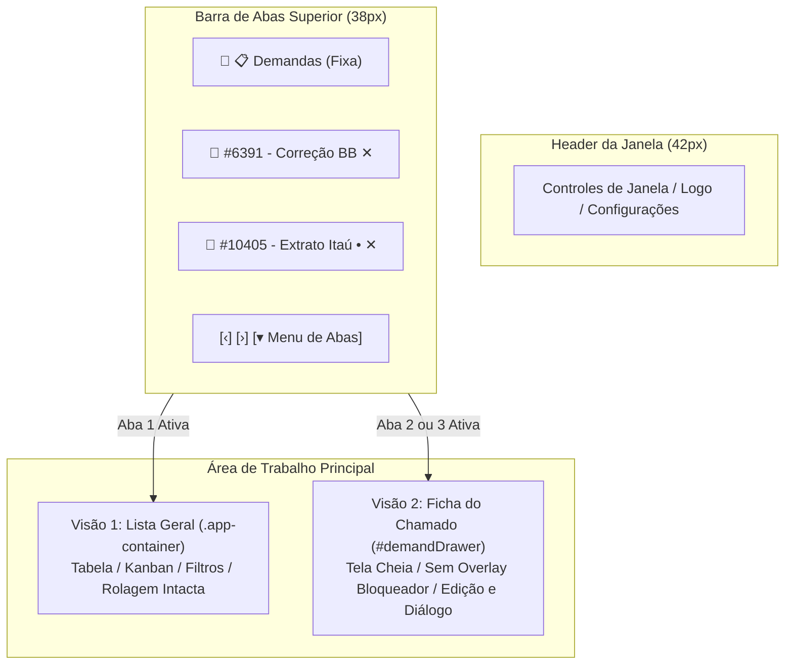
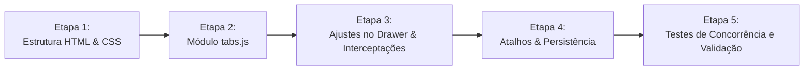

# 📑 Plano Arquitetural & Técnico: Sistema Multi-Abas de Demandas

Este documento apresenta a arquitetura e o roteiro técnico detalhado para transformar a visualização de demandas em um **ambiente de trabalho multi-abas** de alta produtividade (estilo navegadores modernos e IDEs como VS Code).

---

## 1. Visão Geral da Solução

O objetivo é permitir que o usuário:
1. **Mantenha a primeira aba sempre aberta e fixa** como **"📋 Demandas"** (tabela inteligente, quadro Kanban, filtros e barra de busca intactos).
2. **Abra um ou mais chamados simultaneamente**, cada um gerando sua própria aba superior.
3. **Alterne instantaneamente** entre a lista de demandas e qualquer chamado aberto (ou entre diferentes chamados) sem recarregar a tela e sem perder rascunhos de comentários, edições de ficha ou posição de rolagem.
4. **Feche abas individualmente**, com aviso de segurança caso haja alterações ou comentários não salvos.



---

## 2. Decisões Arquiteturais Críticas

### 2.1. Estrutura Visual do DOM e Alternância de Telas
Em vez de clonar estruturas complexas de HTML que gerariam IDs duplicados e conflitos de eventos, a solução adota **Gestão de Sessões em Memória + Alternância de Workspace**:
* **Barra de Abas (`#appTabBar`)**: Inserida no [src/index.html](file:///c:/Users/fulvi/Desktop/PROJETOS/organizador%20de%20chamados/src/index.html) entre a `<header class="window-titlebar">` e a `<div class="app-container">`.
* **Modo Lista (`body` padrão)**: A `.app-container` fica visível normalmente e o `#demandDrawer` permanece oculto.
* **Modo Chamado (`body.ticket-workspace-active`)**:
  - A `.app-container` é ocultada (`display: none`).
  - O `#demandDrawer` deixa de se comportar como modal flutuante centralizado e passa a ocupar **100% da área útil disponível** (`position: static; flex: 1; border: none; border-radius: 0; box-shadow: none;`).
  - O `.drawer-overlay` escuro é desativado para eliminar qualquer sensação de bloqueio modal.

### 2.2. Prevenção de Condições de Corrida (*Race Conditions*)
No código atual de [src/js/ui/drawer.js:1381](file:///c:/Users/fulvi/Desktop/PROJETOS/organizador%20de%20chamados/src/js/ui/drawer.js#L1381), a chamada assíncrona `window.conciliadorAPI.fetchDemandDetails(ticket.id)` atualiza variáveis globais. Para suportar abas concorrentes:
* O novo `TabManager` implementa um guard de requisição (`activeTicketId`).
* Se a resposta de rede chegar enquanto o usuário já navegou para outra aba, a resposta atualiza o **cache da sessão em memória daquele chamado** sem sobrescrever a tela do chamado atualmente visível.

### 2.3. Preservação Total de Rolagem (Scroll)
Ao aplicar `display: none` no motor Blink (Chromium), o deslocamento de rolagem de containers é zerado por padrão.
* O `TabManager` tira um instantâneo de `scrollTop` e `scrollLeft` do `#tableViewContainer` e `#kanbanViewContainer` ao sair da lista.
* Ao voltar para a aba de Demandas, a rolagem é restaurada instantaneamente via `requestAnimationFrame`.

### 2.4. Isolamento da Tecla `Escape`
Em [src/js/app.js:954](file:///c:/Users/fulvi/Desktop/PROJETOS/organizador%20de%20chamados/src/js/app.js#L954), o pressionamento da tecla `Escape` atualmente fecha o drawer e limpa `selectedTicket`.
* No modelo de abas, o `Escape` fechará apenas modais flutuantes (como Lightbox de imagens ou popovers de data).
* O fechamento da aba requer ação explícita (`Ctrl+W`, clique no `✕` da aba ou botão fechar).

### 2.5. Snapshot de Sessão Completo (Rascunhos e Ficha Técnica)
Ao alternar entre abas de chamados, o estado em memória preserva:
1. Sub-aba ativa no drawer (`timeline`, `details` ou `history`).
2. Rascunho de comentário no campo `#drawerNewCommentText`.
3. Anexos/prints colados na fila temporária (`timelinePendingAttachments`).
4. Posição de rolagem interna do diálogo (`#drawerActivityStream`).
5. Todos os 13 campos de edição da ficha técnica ([src/js/ui/drawer.js:1234-1335](file:///c:/Users/fulvi/Desktop/PROJETOS/organizador%20de%20chamados/src/js/ui/drawer.js#L1234-L1335)), incluindo validador, datas, notas locais e editor de descrição rica.
6. Indicador de pendência (*Dirty Dot* `•`) na aba se houver dados não salvos.

---

## 3. Estrutura do Novo Módulo `src/js/ui/tabs.js`

Será criado o componente `TabManager`, instanciado como `window.appTabs`:

```javascript
class TabManager {
  // Estado das abas
  tabs: Array<{
    id: string,          // 'demands-list' ou 'ticket-6391'
    ticketId?: number,
    type: 'list' | 'ticket',
    title: string,
    status: string,
    isPinned: boolean,
    isDirty: boolean
  }>;
  activeTabId: string;
  ticketSessions: Map<number, TicketSessionData>;

  // Métodos principais
  openTicketTab(ticket, switchToTab = true);
  switchToTab(tabId);
  closeTab(tabIdOrTicketId, force = false);
  updateTab(ticketId, partialData);
  saveTicketSession(ticketId);
  restoreTicketSession(ticketId);
  persistOpenTabs();
  restorePersistedTabs();
}
```

---

## 4. Roteiro Passo a Passo de Implementação



### Etapa 1: Estrutura HTML & CSS
1. Inserir `<nav class="app-tab-bar" id="appTabBar">` em [src/index.html](file:///c:/Users/fulvi/Desktop/PROJETOS/organizador%20de%20chamados/src/index.html) logo abaixo da `.window-titlebar`.
2. Incluir a tag `<script src="js/ui/tabs.js"></script>` antes de `drawer.js`.
3. Adicionar estilos no [src/css/style.css](file:///c:/Users/fulvi/Desktop/PROJETOS/organizador%20de%20chamados/src/css/style.css):
   - `.app-tab-bar`, `.tabs-scroll-container`, `.tab-item`, `.tab-item.active`, `.tab-close-btn`.
   - Regras para `body.ticket-workspace-active`: conversão de `#demandDrawer` em tela cheia e ocultação da `.drawer-overlay`.

### Etapa 2: Criação de `src/js/ui/tabs.js`
1. Implementar o ciclo de vida de abas (renderização, ativação, fechamento, rolagem horizontal da barra com roda do mouse).
2. Lógica de captura e restauração de sessões (dados do formulário, scroll da tabela/kanban e diálogo de mensagens).
3. Diálogo de confirmação com `showAppConfirm` caso o usuário tente fechar uma aba com rascunho ou edições pendentes.

### Etapa 3: Integração dos Gatilhos de Abertura e Sincronização
1. Substituir chamadas diretas de `openDemandDrawer(ticket)` por `window.appTabs.openTicketTab(ticket)` em:
   - [src/js/ui/table-kanban.js:283](file:///c:/Users/fulvi/Desktop/PROJETOS/organizador%20de%20chamados/src/js/ui/table-kanban.js#L283) (clique na tabela).
   - [src/js/ui/table-kanban.js:789](file:///c:/Users/fulvi/Desktop/PROJETOS/organizador%20de%20chamados/src/js/ui/table-kanban.js#L789) (clique no card Kanban).
   - [src/js/ui/layouts-browser.js:520](file:///c:/Users/fulvi/Desktop/PROJETOS/organizador%20de%20chamados/src/js/ui/layouts-browser.js#L520) (clique em chamado no navegador de layouts).
   - [src/js/ui/calendar.js:1835](file:///c:/Users/fulvi/Desktop/PROJETOS/organizador%20de%20chamados/src/js/ui/calendar.js#L1835) (abertura pós-criação de demanda).
2. Atualizar o cabeçalho do drawer:
   - Adicionar botão rápido `← Voltar à Lista` ao lado do título para permitir ir à lista sem fechar a aba.
   - O botão `✕` do drawer passa a fechar a aba ativa.
3. Desacoplar o fechamento total no `Escape` em [src/js/app.js:954](file:///c:/Users/fulvi/Desktop/PROJETOS/organizador%20de%20chamados/src/js/app.js#L954).
4. Notificar a aba quando o status ou título for alterado via `saveDrawerTicketChanges`.

### Etapa 4: Atalhos de Teclado e Persistência
1. Implementar atalhos:
   - `Ctrl + W`: Fecha a aba ativa (exceto a aba de lista).
   - `Ctrl + Tab` / `Ctrl + Shift + Tab`: Alterna abas sequencialmente.
   - `Ctrl + 1`: Retorna à Lista de Demandas.
   - `Ctrl + 2` a `Ctrl + 9`: Foca na aba correspondente.
   - Clique com o botão do meio do mouse (scroll click): Fecha a aba.
2. Persistir abas abertas no `localStorage` / `electronAPI.saveStorage` para que, ao reabrir o aplicativo, o usuário encontre seu espaço de trabalho exatamente como deixou.

---

## 5. Experiência do Usuário (Exemplos de Fluxo)

* **Cenário 1: Comparar dois chamados do mesmo layout**
  O usuário clica no chamado #6391 (abre aba 2) e depois no #6392 no navegador de layouts (abre aba 3). Alterna entre os dois com `Ctrl+Tab` instantaneamente para conferir validações.
* **Cenário 2: Atendimento interrompido**
  O usuário está redigindo um comentário técnico longo no chamado #10405. Um colega pede para verificar o chamado #8012 na lista. O usuário clica em `📋 Demandas` (ou `Ctrl+1`), pesquisa o chamado #8012, confere os dados e clica de volta na aba do #10405: o comentário rascunhado e os prints colados continuam intactos.
* **Cenário 3: Fechamento acidental**
  Se o usuário acidentalmente clicar no `✕` de uma aba que contenha texto rascunhado ou campos alterados, o sistema exibe o aviso com opções de confirmar ou cancelar, impedindo perda de dados.
